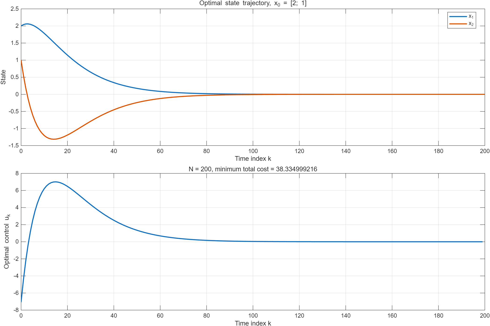
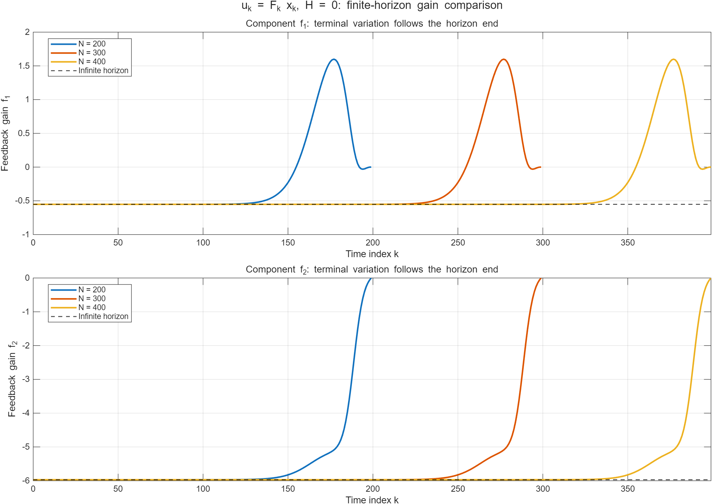

本文对应《Homework for Chap3-2026》的 3-1 至 3-6 题。教材引用依据工作目录中的 Kirk《Optimal Control Theory: An Introduction》第三章扫描件。离散系统采用正向时标 $k$；$V_k(x)$ 表示从时刻 $k$ 的状态 $x$ 出发，到指定终点的最小剩余代价。第 3-3 题采用教材图 3-9 的 $N=200$、$x_0=[2,1]^T$，并延长到 $N=400$ 提供 $k\geq300$ 的结果。

# 3-1　一阶离散系统的动态规划

## 题目与量化网格

系统和性能指标为

$$
x_{k+1}=-\frac12x_k+u_k,\qquad
J=|x_0|+|x_1|+|x_2|.
$$

状态约束为 $-2\leq x_k\leq2$，控制约束为 $-1\leq u_k\leq1$。按题意取

$$
\mathcal X=\{-2,-1,0,1,2\},\qquad
\mathcal U=\{-1,-0.5,0,0.5,1\}.
$$

先在状态网格上倒推价值函数；若下一状态落在网格点之间，则对**价值函数**作线性插值。具体地，若 $z\in[x_i,x_{i+1}]$，则

$$
\widetilde V(z)=\frac{x_{i+1}-z}{x_{i+1}-x_i}V(x_i)
+\frac{z-x_i}{x_{i+1}-x_i}V(x_{i+1}).
$$

本题对所有 $x\in\mathcal X$、$u\in\mathcal U$，下一状态均在 $[-2,2]$ 内，因此表中没有不可行项。

## （a）从终点向前递推

**终端阶段 $k=2$。** 无剩余控制，故

$$
V_2(x)=|x|.
$$

| $x$ | $-2$ | $-1$ | $0$ | $1$ | $2$ |
|:---:|---:|---:|---:|---:|---:|
| $V_2(x)$ | 2 | 1 | 0 | 1 | 2 |

**阶段 $k=1$。** Bellman 方程为

$$
V_1(x)=\min_{u\in\mathcal U}\left\{|x|+
\widetilde V_2\left(-\frac12x+u\right)\right\}.
$$

由于 $V_2(x)=|x|$ 在相邻网格区间上均为线性函数，线性插值恰好给出真实的绝对值。例如 $x=-1,u=-1$ 时，下一状态 $z=-0.5$，有

$$
\widetilde V_2(-0.5)=\tfrac12V_2(-1)+\tfrac12V_2(0)=0.5,
$$

故对应代价为 $1+0.5=1.5$。逐项计算得到下表；中间五列均为“当前状态代价加最优后续代价”。

| $x$ | $u=-1$ | $u=-0.5$ | $u=0$ | $u=0.5$ | $u=1$ | $V_1(x)$ | $u_1^*(x)$ |
|:---:|---:|---:|---:|---:|---:|---:|---:|
| $-2$ | 2 | 2.5 | 3 | 3.5 | 4 | 2 | $-1$ |
| $-1$ | 1.5 | 1 | 1.5 | 2 | 2.5 | 1 | $-0.5$ |
| $0$ | 1 | 0.5 | 0 | 0.5 | 1 | 0 | $0$ |
| $1$ | 2.5 | 2 | 1.5 | 1 | 1.5 | 1 | $0.5$ |
| $2$ | 4 | 3.5 | 3 | 2.5 | 2 | 2 | $1$ |

因此在网格点上，$V_1(x)=|x|$，且 $u_1^*(x)=x/2$。

**阶段 $k=0$。** 由

$$
V_0(x)=\min_{u\in\mathcal U}\left\{|x|+
\widetilde V_1\left(-\frac12x+u\right)\right\},
$$

并利用 $V_1$ 的网格值仍为 $\{2,1,0,1,2\}$，得到

| $x$ | $u=-1$ | $u=-0.5$ | $u=0$ | $u=0.5$ | $u=1$ | $V_0(x)$ | $u_0^*(x)$ |
|:---:|---:|---:|---:|---:|---:|---:|---:|
| $-2$ | 2 | 2.5 | 3 | 3.5 | 4 | 2 | $-1$ |
| $-1$ | 1.5 | 1 | 1.5 | 2 | 2.5 | 1 | $-0.5$ |
| $0$ | 1 | 0.5 | 0 | 0.5 | 1 | 0 | $0$ |
| $1$ | 2.5 | 2 | 1.5 | 1 | 1.5 | 1 | $0.5$ |
| $2$ | 4 | 3.5 | 3 | 2.5 | 2 | 2 | $1$ |

网格上的最优控制律为

$$
\boxed{u_k^*(x)=\frac{x}{2},\quad x\in\mathcal X,\quad k=0,1.}
$$

对原题的连续控制区间，上式在整个 $[-2,2]$ 上精确最优：下一状态为零，达到下界 $J\geq|x|$。若控制只能取五个量化值，则上表只适用于状态网格点，网格外的 $x/2$ 不一定是可取的量化控制。

## （b）初始状态 $x_0=1$

由 $u_0^*=1/2$，有 $x_1=-1/2+1/2=0$；继而 $u_1^*=0$、$x_2=0$。因此

$$
\boxed{\{u_0^*,u_1^*\}=\{0.5,0\},\qquad
\{x_0^*,x_1^*,x_2^*\}=\{1,0,0\},\qquad J^*=1.}
$$

# 3-2　Bellman 递推方程的详细推导

## 问题定义与最优性原理

考虑确定性离散系统

$$
x_{i+1}=f_i(x_i,u_i),\qquad i=k,\ldots,N-1,
$$

性能指标为

$$
J_{k,N}=h(x_N)+\sum_{i=k}^{N-1}g_i(x_i,u_i).
$$

定义 $\mathcal U_k(x)$ 为在当前状态 $x$ 下能够选取、并可延续为可行后续轨迹的控制集合。若某个状态没有任何可行的后续控制，可将该处价值记为 $+\infty$。价值函数定义为

$$
V_k(x)=\min_{u_k,\ldots,u_{N-1}}
\left\{h(x_N)+\sum_{i=k}^{N-1}g_i(x_i,u_i)\right\},
\qquad x_k=x.
$$

Bellman 最优性原理指出：从某初始状态出发的最优控制序列，在执行第一步后，其剩余控制序列必须对到达的新状态仍然最优。

证明可用反证法：若该后续序列不是最优的，就能用一个代价更小的可行后续序列替换它，同时保留第一步控制；这样得到的完整序列代价更小，与原序列最优矛盾。这个替换成立的基础是：状态已包含决定后续动态、代价和可行性所需的信息。

## 分离第一步控制

把总代价拆为当前阶段和后续阶段：

$$
J_{k,N}=g_k(x,u_k)+
\left[h(x_N)+\sum_{i=k+1}^{N-1}g_i(x_i,u_i)\right].
$$

给定第一步控制 $u_k=u$ 后，下一状态就确定为 $x_{k+1}=f_k(x,u)$。因此，对全部控制序列的最小化可以先对后续序列最小化，再对第一步控制最小化：

$$
\begin{aligned}
V_k(x)
&=\min_{u\in\mathcal U_k(x)}\left\{g_k(x,u)
+\min_{u_{k+1},\ldots,u_{N-1}}
\left[h(x_N)+\sum_{i=k+1}^{N-1}g_i(x_i,u_i)\right]\right\}\\
&=\min_{u\in\mathcal U_k(x)}
\left\{g_k(x,u)+V_{k+1}(f_k(x,u))\right\}.
\end{aligned}
$$

故 Bellman 递推方程及终端条件为

$$
\boxed{V_k(x)=\min_{u\in\mathcal U_k(x)}
\{g_k(x,u)+V_{k+1}(f_k(x,u))\},\quad V_N(x)=h(x).}
$$

最优反馈律为

$$
\boxed{u_k^*(x)\in\operatorname*{arg\,min}_{u\in\mathcal U_k(x)}
\{g_k(x,u)+V_{k+1}(f_k(x,u))\}.}
$$

其充分性也可直接验证：任一可行序列的后续代价不小于 $V_{k+1}$，故总代价不小于右端最小值；选取右端的最优第一步控制，再接上相应最优后续序列，即可达到该值。若最小值不能取得，以上用 $\inf$ 代替 $\min$，并用任意精度的近优序列论证。

## 计算次序与连续时间形式

计算时先给出 $V_N=h$，再按 $k=N-1,N-2,\ldots,0$ 倒推，同时存储最优反馈律。给定 $x_0$ 后，再按 $u_k^*=u_k^*(x_k^*)$、$x_{k+1}^*=f_k(x_k^*,u_k^*)$ 正向恢复最优序列，最小总代价为 $V_0(x_0)$。

对连续系统 $\dot x=a(x,u,t)$，相应的动态规划原理为

$$
V(x,t)=\min_{u(\cdot)|_{[t,t+\Delta t]}}
\left\{\int_t^{t+\Delta t}g(x(\tau),u(\tau),\tau)\,d\tau
+V(x(t+\Delta t),t+\Delta t)\right\}.
$$

在 $V$ 可微等适当条件下，取短时间段内近似常值控制，有

$$
x(t+\Delta t)=x+a(x,u,t)\Delta t+o(\Delta t),
$$

$$
V(x(t+\Delta t),t+\Delta t)
=V(x,t)+(V_t+V_x^Ta)\Delta t+o(\Delta t).
$$

代入、消去 $V(x,t)$、除以 $\Delta t$ 并令其趋于零，即得

$$
\boxed{0=V_t(x,t)+\min_{u\in\mathcal U(x,t)}
\{g(x,u,t)+V_x(x,t)^Ta(x,u,t)\},\quad V(x,T)=h(x).}
$$

这就是连续时间的 Hamilton–Jacobi–Bellman 方程，第 3-4、3-6 题均由此出发。

# 3-3　有限时域线性二次型最优控制与末端增益变化

## 问题、符号与 Riccati 递推

教材例 3.10-1 的系统为

$$
x_{k+1}=Ax_k+Bu_k,\qquad
A=\begin{bmatrix}0.9974&0.0539\\-0.1078&1.1591\end{bmatrix},\quad
B=\begin{bmatrix}0.0013\\0.0539\end{bmatrix}.
$$

性能指标为

$$
J=\frac12\sum_{k=0}^{N-1}(x_k^TQx_k+Ru_k^2),\qquad
Q=\operatorname{diag}(0.25,0.05),\quad R=0.05.
$$

本题没有状态或控制幅值约束，也没有终端代价。按教材图 3-9，第一问取 $N=200$、$x_0=[2,1]^T$。采用含负号的增益定义

$$
u_k^*=F_kx_k,\qquad V_k(x)=\tfrac12x^TP_kx,\qquad P_N=0.
$$

将二次型价值函数代入 Bellman 方程：

$$
V_k(x)=\min_u\frac12\left[x^TQx+Ru^2+(Ax+Bu)^TP_{k+1}(Ax+Bu)\right].
$$

对 $u$ 求导，有

$$
(R+B^TP_{k+1}B)u+B^TP_{k+1}Ax=0.
$$

由于 $R+B^TP_{k+1}B>0$，二次函数严格凸，驻点为唯一全局最小点。因此

$$
\boxed{F_k=-(R+B^TP_{k+1}B)^{-1}B^TP_{k+1}A,}
$$

$$
\boxed{P_k=Q+A^TP_{k+1}A
-A^TP_{k+1}B(R+B^TP_{k+1}B)^{-1}B^TP_{k+1}A.}
$$

等价的、便于检查半正定性的形式为

$$
P_k=Q+F_k^TRF_k+(A+BF_k)^TP_{k+1}(A+BF_k).
$$

由 $P_N=0$ 倒推到 $P_0$，再由给定初态正推最优状态和控制，得到 $J^*=\tfrac12x_0^TP_0x_0$。

## （1）$k=0,1,2,3,4$ 的最优控制与最小代价

计算得到

$$
P_0\simeq\begin{bmatrix}
16.522626305&1.017384183\\
1.017384183&6.509956480
\end{bmatrix}.
$$

| $k$ | $x_1^*(k)$ | $x_2^*(k)$ | $u_k^*$ | $V_k(x_k^*)$ |
|---:|---:|---:|---:|---:|
| 0 | 2.000000000 | 1.000000000 | $-7.073474398$ | 38.334999216 |
| 1 | 2.039504483 | 0.562239730 | $-4.482292288$ | 36.559148215 |
| 2 | 2.058679513 | 0.190237933 | $-2.272396971$ | 35.529024456 |
| 3 | 2.060626655 | $-0.123903060$ | $-0.398359913$ | 34.869254827 |
| 4 | 2.048072783 | $-0.387223189$ | 1.180334534 | 34.334130986 |

所以前五步最优控制为

$$
\boxed{\{u_0^*,\ldots,u_4^*\}\simeq
\{-7.073474398,-4.482292288,-2.272396971,-0.398359913,1.180334534\},}
$$

$$
\boxed{J_{0,200}^*=38.334999216386.}
$$

表中最后一列是**沿同一条最优轨迹、到固定终点 $N=200$ 的最小剩余代价**。它满足

$$
V_k(x_k^*)=\tfrac12[(x_k^*)^TQx_k^*+R(u_k^*)^2]
+V_{k+1}(x_{k+1}^*).
$$

例如第一步阶段代价为 $1.775851001$，故 $38.334999216-1.775851001=36.559148215$。这些数值没有把总时域改为 $0,1,2,3,4$。

{width=88%}

## （2）约 $k=150$ 后增益显著变化的原因

**先澄清教材原文。** 教材第 84 页的结论是：在相应条件下，无限时域的最优反馈增益趋于一个**常数矩阵**。作业中“$F(N-k)$ 趋于无穷”的引述有误。对本题，更清楚的表述是

$$
N-k\longrightarrow\infty
\quad\Longrightarrow\quad F_k^{(N)}\longrightarrow F_\infty.
$$

这里的极限要求**剩余时域很长**；固定 $N=200$ 而令 $k$ 接近 200，会使剩余时域变短。原图横轴为离散步数 $k$；题目没有给出采样周期，故图中的 150 不能直接解释为 150 秒。

本例 $Q>0$、$R>0$，且 $\operatorname{rank}[B,AB]=2$，满足相应的 LQR 稳态收敛条件。按教材印出的系统参数求得代数 Riccati 方程的稳定化解

$$
P_\infty\simeq\begin{bmatrix}
16.522626305&1.017384183\\1.017384183&6.509956480
\end{bmatrix},\qquad
F_\infty\simeq[-0.5522296545,\,-5.9690150887].
$$

教材给出的第二分量为 $-5.9668$，与直接使用印刷参数重算的值略有差别；本文统一使用印刷的 $A,B,Q,R$ 计算。

**末端变化来自终端条件 $P_N=0$。** 最后一步的优化是

$$
V_{N-1}(x)=\min_u\tfrac12(x^TQx+Ru^2).
$$

此时 $x$ 已经给定，而 $u$ 只能改变未被计入目标函数的 $x_N$，所以

$$
\boxed{F_{N-1}=0,\qquad u_{N-1}^*=0,\qquad P_{N-1}=Q.}
$$

再向前一步，得到

$$
F_{N-2}=-(R+B^TQB)^{-1}B^TQA
\simeq[-0.0006707257,\,-0.0626433187].
$$

因此，靠近终点时增益必须从长剩余时域下的稳态值过渡到零。二阶系统的耦合使增益分量可以非单调变化，第一分量出现正向凸起。这里没有发散：$P_k\succeq0$，因而

$$
R+B^TP_{k+1}B\geq0.05>0,
$$

不存在由该分母趋于零引发的奇异性。“150”只是本例在 $N=200$ 下开始出现明显变化的大致位置，并非固定的突变时刻。

## 延长时域及 $k\geq300$ 的数值与图形

原时域 $N=200$ 的控制只定义在 $k=0,\ldots,199$。为给出 $k\geq300$ 的增益，重新求解 $N=300,400$，其中 $N=400$ 包含 $k=300,\ldots,399$。

由于系统、代价权重和终端条件不随时间变化，增益只由剩余步数决定：

$$
\boxed{F_{k+100}^{(N+100)}=F_k^{(N)}.}
$$

| 时域 $N$ | 剩余 50 步时的 $k$ | 此时 $f_1$ | 此时 $f_2$ | $f_1$ 峰值位置 |
|---:|---:|---:|---:|---:|
| 200 | 150 | $-0.228729833$ | $-5.825762506$ | 177 |
| 300 | 250 | $-0.228729833$ | $-5.825762506$ | 277 |
| 400 | 350 | $-0.228729833$ | $-5.825762506$ | 377 |

三个时域的 $f_1$ 峰值均为 $1.598638754$。末端变化区间随终点后移；按剩余步数作图时，曲线重合。

{width=90%}

对于 $N=400$，部分 $k\geq300$ 的结果为：

| $k$ | $f_1(k)$ | $f_2(k)$ |
|---:|---:|---:|
| 300 | $-0.551939197$ | $-5.968866586$ |
| 330 | $-0.528609720$ | $-5.957643382$ |
| 350 | $-0.228729833$ | $-5.825762506$ |
| 370 | 1.263471964 | $-5.284006737$ |
| 377 | 1.598638754 | $-5.089583367$ |
| 380 | 1.506770670 | $-4.903992945$ |
| 390 | 0.129745646 | $-1.920526136$ |
| 395 | $-0.026378951$ | $-0.412206705$ |
| 398 | $-0.000670726$ | $-0.062643319$ |
| 399 | 0 | 0 |

作为进一步验证，若把终端代价改成 $\tfrac12x_N^TP_\infty x_N$，即取 $P_N=P_\infty$，则 Riccati 递推始终停留在固定点，所有阶段都有 $F_k=F_\infty$。这也说明原图中的末端变化由有限时域及零终端代价共同造成。本文保留图表与数据，不附 MATLAB 代码。

# 3-4　Kirk 习题 3.8：连续时间标量 LQR

## 原题与 HJB 方程

教材第 99 页的系统和指标为

$$
\dot x=-10x+u,\qquad T=0.04,
$$

$$
J=\frac12x^2(T)+\int_0^T\left[\frac14x^2(t)+\frac12u^2(t)\right]dt.
$$

状态与控制均无边界约束。注意状态运行代价的系数为 $1/4$。定义

$$
V(x,t)=\min_{u(\cdot)}\left\{\frac12x^2(T)
+\int_t^T\left(\frac14x^2+\frac12u^2\right)d\tau\right\}.
$$

HJB 方程与终端条件是

$$
0=V_t+\min_{u\in\mathbb R}
\left\{\frac14x^2+\frac12u^2+V_x(-10x+u)\right\},
\qquad V(x,T)=\frac12x^2.
$$

对 $u$ 求导，得到 $u+V_x=0$。由于关于 $u$ 的二阶导数为 1，故

$$
\boxed{u^*(x,t)=-V_x(x,t).}
$$

代回 HJB 方程，得

$$
0=V_t+\frac14x^2-10xV_x-\frac12V_x^2.
$$

## 二次型设定与 Riccati 微分方程

设

$$
V(x,t)=\frac12P(t)x^2.
$$

则 $V_t=\tfrac12\dot P x^2$、$V_x=Px$。代入后有

$$
0=\left(\frac12\dot P+\frac14-10P-\frac12P^2\right)x^2.
$$

因此

$$
\boxed{\dot P=P^2+20P-\frac12,\qquad P(0.04)=1,\qquad u^*(t)=-P(t)x(t).}
$$

这里给出的是终端条件，需从 $T$ 向前求解。

## Riccati 方程的显式解

令

$$
\lambda=\sqrt{100.5},\qquad
p_+=-10+\lambda,\qquad p_-=-10-\lambda.
$$

则 $\dot P=(P-p_+)(P-p_-)$。分离变量并积分，利用 $P(T)=1$ 得

$$
\frac{P(t)-p_+}{P(t)-p_-}
=\frac{1-p_+}{1-p_-}\,e^{2\lambda(t-T)}.
$$

记

$$
z(t)=\frac{1-p_+}{1-p_-}\,e^{-2\lambda(T-t)},
$$

解出

$$
\boxed{P(t)=\frac{p_+-p_-z(t)}{1-z(t)},\qquad 0\leq t\leq0.04.}
$$

所以最优反馈律和价值函数为

$$
\boxed{u^*(x,t)=-\frac{p_+-p_-z(t)}{1-z(t)}\,x,\qquad
V(x,t)=\frac12P(t)x^2.}
$$

| $t$ | 0 | 0.01 | 0.02 | 0.03 | 0.04 |
|:---:|---:|---:|---:|---:|---:|
| $P(t)$ | 0.450782794 | 0.547784058 | 0.667575894 | 0.815870649 | 1.000000000 |

对任意给定初态 $x(0)=x_0$，最小总代价为

$$
\boxed{J^*=\frac12P(0)x_0^2\simeq0.225391397\,x_0^2.}
$$

## 最优性验证

沿任意可行状态和控制，由 Riccati 方程可得

$$
\begin{aligned}
\frac14x^2+\frac12u^2+\frac{d}{dt}\left(\frac12Px^2\right)
&=\frac14x^2+\frac12u^2+\frac12\dot P x^2+Px(-10x+u)\\
&=\frac12(u+Px)^2.
\end{aligned}
$$

在 $[0,T]$ 积分，并利用 $P(T)=1$，有

$$
J=\frac12P(0)x_0^2+\frac12\int_0^T[u(t)+P(t)x(t)]^2dt
\geq\frac12P(0)x_0^2.
$$

取 $u=-Px$ 时等号成立，因而所求反馈律达到全局最小值。

# 3-5　Kirk 习题 3.10：标量离散最优跟踪

## 原题及目标函数系数

教材第 99–100 页给出

$$
x_{k+1}=Ax_k+Bu_k,
$$

$$
J=\frac12H x_N^2+\sum_{k=0}^{N-1}
\left[Q(x_k-r)^2+Ru_k^2\right],\qquad Q,R>0.
$$

（a）求常数参考值 $r$ 下的最优控制律；（b）当 $N=3$，参考值为已知的 $r_k=r(k)$ 时，重复推导。采用通常的非负终端权重 $H\geq0$。

**按扫描件原式，只有终端项前有 $1/2$，求和项前没有 $1/2$。** 下文采用

$$
V_k(x)=p_kx^2-2s_kx+c_k
$$

的记号，因此终端条件为 $p_N=H/2$、$s_N=0$、$c_N=0$。

## （a）常数参考值：配方与递推

先允许参考值写成 $r_k$，以便同时覆盖两问。假设下一阶段价值函数为

$$
V_{k+1}(y)=p_{k+1}y^2-2s_{k+1}y+c_{k+1}.
$$

Bellman 方程为

$$
V_k(x)=\min_u\{Q(x-r_k)^2+Ru^2+V_{k+1}(Ax+Bu)\}.
$$

将右端展开，并令 $D_k=R+B^2p_{k+1}$：

$$
\begin{aligned}
V_k(x)=\min_u\big\{&D_ku^2+2B(Ap_{k+1}x-s_{k+1})u\\
&+(Q+A^2p_{k+1})x^2
-2(Qr_k+As_{k+1})x+Qr_k^2+c_{k+1}\big\}.
\end{aligned}
$$

由 $p_{k+1}\geq0$、$R>0$，有 $D_k>0$，因此最优控制唯一，且

$$
\boxed{u_k^*(x)=-\frac{ABp_{k+1}}{D_k}x
+\frac{Bs_{k+1}}{D_k}.}
$$

代回最小值，相当于减去

$$
\frac{B^2(Ap_{k+1}x-s_{k+1})^2}{D_k}.
$$

比较 $x^2$、$x$ 和常数项，得

$$
\boxed{\begin{aligned}
p_k&=Q+A^2p_{k+1}-\frac{A^2B^2p_{k+1}^2}{D_k}
=Q+\frac{A^2R p_{k+1}}{D_k},\\
s_k&=Qr_k+As_{k+1}-\frac{AB^2p_{k+1}s_{k+1}}{D_k}
=Qr_k+\frac{ARs_{k+1}}{D_k},\\
c_k&=Qr_k^2+c_{k+1}-\frac{B^2s_{k+1}^2}{D_k},\\
D_k&=R+B^2p_{k+1}.
\end{aligned}}
$$

终端条件为

$$
\boxed{p_N=H/2,\quad s_N=0,\quad c_N=0.}
$$

常数参考值情形，令所有 $r_k=r$，即可从 $N-1$ 倒推到 0。给定初态 $x_0$ 后，最小总代价为

$$
\boxed{J^*=p_0x_0^2-2s_0x_0+c_0.}
$$

控制律包含状态反馈项和由参考值决定的前馈项。$p_k$ 与参考值无关，$s_k$ 则编码未来参考值对当前决策的影响。由于原题终端代价为 $Hx_N^2/2$，不能改写成 $H(x_N-r)^2/2$。

## （b）$N=3$、已知时变参考值

记 $r_0=r(0)$、$r_1=r(1)$、$r_2=r(2)$。目标为

$$
J=\frac12Hx_3^2+\sum_{k=0}^{2}[Q(x_k-r_k)^2+Ru_k^2].
$$

**终端 $k=3$：**

$$
p_3=\frac H2,\qquad s_3=0,\qquad c_3=0.
$$

**阶段 $k=2$：** 令 $D_2=R+B^2H/2$，得到

$$
\begin{aligned}
p_2&=Q+\frac{A^2R(H/2)}{D_2},\\
s_2&=Qr_2,\qquad c_2=Qr_2^2,
\end{aligned}
\qquad
\boxed{u_2^*(x_2)=-\frac{AB(H/2)}{D_2}x_2.}
$$

这里没有关于 $r_2$ 的前馈项，因为 $Q(x_2-r_2)^2$ 已由当前状态确定；$u_2$ 只能影响终端状态 $x_3$，而终端目标是惩罚 $x_3$ 本身。

**阶段 $k=1$：** 令 $D_1=R+B^2p_2$，则

$$
\begin{aligned}
p_1&=Q+\frac{A^2R p_2}{D_1},\\
s_1&=Qr_1+\frac{ARQ r_2}{D_1},\\
c_1&=Q(r_1^2+r_2^2)-\frac{B^2Q^2r_2^2}{D_1},
\end{aligned}
$$

$$
\boxed{u_1^*(x_1)=-\frac{ABp_2}{D_1}x_1+\frac{BQ r_2}{D_1}.}
$$

**阶段 $k=0$：** 令 $D_0=R+B^2p_1$，则

$$
\begin{aligned}
p_0&=Q+\frac{A^2R p_1}{D_0},\\
s_0&=Qr_0+\frac{AR}{D_0}
\left(Qr_1+\frac{ARQ r_2}{D_1}\right),\\
c_0&=Q(r_0^2+r_1^2+r_2^2)
-\frac{B^2Q^2r_2^2}{D_1}
-\frac{B^2}{D_0}\left(Qr_1+\frac{ARQ r_2}{D_1}\right)^2.
\end{aligned}
$$

因此

$$
\boxed{u_0^*(x_0)=-\frac{ABp_1}{D_0}x_0
+\frac{BQ}{D_0}\left(r_1+\frac{AR}{D_1}r_2\right).}
$$

这三个公式给出了完整的最优反馈律。对指定初态，实际序列由

$$
u_0^*=u_0^*(x_0),\quad x_1^*=Ax_0+Bu_0^*,\quad
u_1^*=u_1^*(x_1^*),\quad x_2^*=Ax_1^*+Bu_1^*,\quad
u_2^*=u_2^*(x_2^*)
$$

依次得到，最小代价仍为 $p_0x_0^2-2s_0x_0+c_0$。注意 $r_0$ 不直接出现在 $u_0^*$ 中，因为初始状态已给定，初始跟踪误差不能由当前控制改变；它仍会影响最小总代价。

## 配方验证

令 $u_k^*(x)$ 为上式所得控制，完整的 Bellman 右端可写为

$$
Q(x-r_k)^2+Ru^2+V_{k+1}(Ax+Bu)
=V_k(x)+D_k[u-u_k^*(x)]^2.
$$

沿任意可行轨迹求和，利用 $V_3(x_3)=Hx_3^2/2$（一般时域则为 $V_N$），得

$$
J=V_0(x_0)+\sum_{k=0}^{N-1}D_k[u_k-u_k^*(x_k)]^2\geq V_0(x_0).
$$

因为 $D_k>0$，采用上述反馈律时恰好取等，证明递推式给出全局最优解。

# 3-6　有控制幅值约束的 HJB 最小化

## 提取与控制有关的项

系统为

$$
\dot x_1=0.5x_2,\qquad
\dot x_2=-0.5x_1+x_2+u,
$$

性能指标和约束为

$$
J=\int_0^T\frac12(q_1x_1^2+q_2x_2^2+u^2)\,dt,
\qquad q_1,q_2>0,\qquad |u|\leq1.
$$

令 $V=J^*$，并记

$$
p_1=\frac{\partial V}{\partial x_1}(x_1,x_2,t),\qquad
p_2=\frac{\partial V}{\partial x_2}(x_1,x_2,t).
$$

HJB 花括号内的表达式为

$$
\mathcal H=\frac12(q_1x_1^2+q_2x_2^2)
+0.5p_1x_2+p_2(-0.5x_1+x_2)
+\frac12u^2+p_2u.
$$

固定 $x,t,p_1,p_2$ 后，前面各项均与 $u$ 无关，所以只需解

$$
\min_{-1\leq u\leq1}\left(\frac12u^2+p_2u\right).
$$

配方为

$$
\frac12u^2+p_2u=\frac12(u+p_2)^2-\frac12p_2^2.
$$

无约束极小点为 $u=-p_2$；有约束时，应取它在闭区间 $[-1,1]$ 上的投影。

## 最优可容许控制

$$
\boxed{u^*(x,t)=\operatorname{proj}_{[-1,1]}
\left[-\frac{\partial J^*}{\partial x_2}(x,t)\right]
=\max\left\{-1,\min\left[1,-\frac{\partial J^*}{\partial x_2}(x,t)\right]\right\}.}
$$

分段表达式为

$$
\boxed{u^*(x,t)=
\begin{cases}
+1,&\displaystyle \frac{\partial J^*}{\partial x_2}<-1,\\[4pt]
-\displaystyle\frac{\partial J^*}{\partial x_2},
&\displaystyle -1\leq\frac{\partial J^*}{\partial x_2}\leq1,\\[4pt]
-1,&\displaystyle \frac{\partial J^*}{\partial x_2}>1.
\end{cases}}
$$

在两处分界点上表达式一致；因为目标关于 $u$ 严格凸，最优控制唯一。控制直接进入第二个状态方程，所以控制律显式依赖 $J^*_{x_2}$；$x,t$ 通过这个偏导数进入控制律。权重 $q_1,q_2$ 影响价值函数，进而影响该偏导数。

## 代回 HJB 方程

定义

$$
\psi(p)=\min_{|u|\leq1}\left(\frac12u^2+pu\right)
=\begin{cases}
-\frac12p^2,&|p|\leq1,\\[2pt]
\frac12-|p|,&|p|>1.
\end{cases}
$$

于是约束 HJB 方程可写成

$$
0=V_t+\frac12(q_1x_1^2+q_2x_2^2)
+0.5x_2V_{x_1}+(-0.5x_1+x_2)V_{x_2}+\psi(V_{x_2}),
\qquad V(x,T)=0.
$$

终端条件来自无终端代价。题目只要求用 $x,t,J_x^*$ 表示最优可容许控制，因此上述饱和反馈律已经完成所求，无需继续求解整个偏微分方程。

---

**核对依据：** 作业原始 PDF 共一页；第 3-3 题对照 Kirk 教材第 83–86 页，3-4 对照第 99 页习题 3.8，3-5 对照第 99–100 页习题 3.10。第 3-3 题数值结果按教材印刷参数计算，并与本目录已有 CSV 数据及图形核对；本文不包含 MATLAB 代码。
